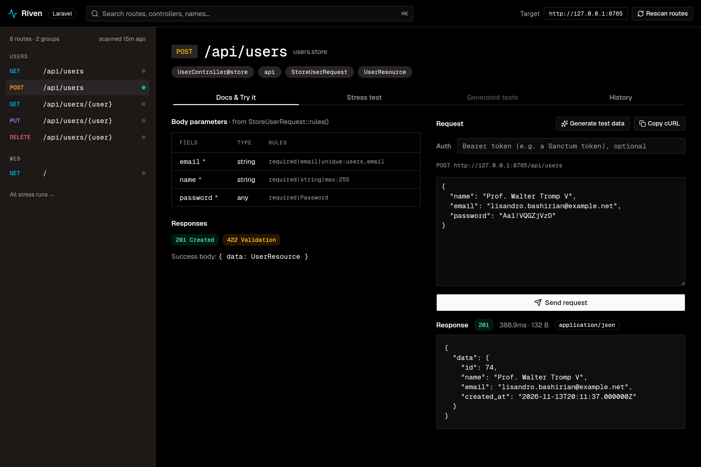
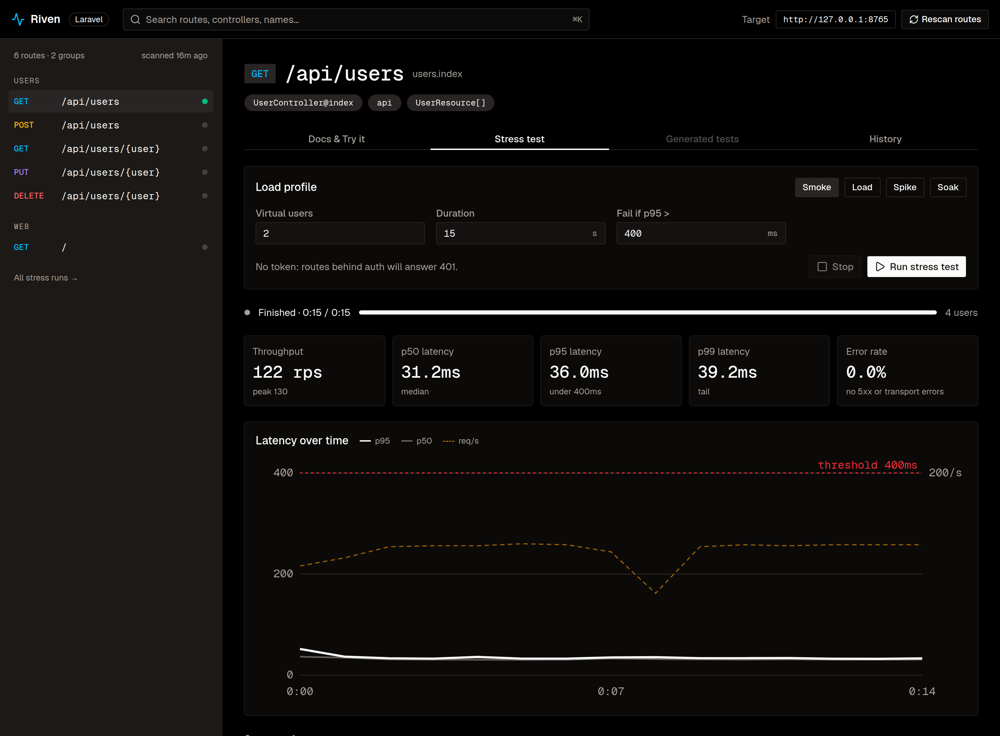

<p align="center">
  
  
  
</p>

# Riven

**API docs, a request playground and load tests for your Laravel app, generated from the code you already have.**

Riven reads your routes, FormRequest rules and API Resources, then gives you a local dashboard to browse every endpoint, send real requests with generated test data, and stress test them, without writing a spec by hand.



## How it works

1. **The package** (`faysal/riven`) runs inside your app. `php artisan riven:export` writes `riven.json`, which lists every route with its middleware, parameters, validation rules and response Resource.
2. **The engine** (`riven-engine`, one Go binary) reads that file. It prints the routes, builds an OpenAPI 3.1 document, runs load tests, and serves the dashboard.
3. **The dashboard** sends Try it and stress requests to your app, and updates by itself when you add or change a route.

## Install

```bash
composer require faysal/riven --dev
```

Download the engine binary for your platform after every Composer install, by adding one line to your app's `composer.json`:

```json
"scripts": {
    "post-autoload-dump": [
        "...",
        "@php artisan riven:install-engine --ansi"
    ]
}
```

The binary comes from this repository's GitHub release for your installed version and is checked against its SHA-256 checksum before it's installed to `vendor/bin/riven-engine`.

## Use it

```bash
php artisan serve                     # your app
vendor/bin/riven-engine serve         # the dashboard on http://127.0.0.1:7600
```

`serve` runs `riven:export` for you whenever your routes or controllers change. On each endpoint:

- **Docs & Try it**: body fields and rules, responses, and a request panel. **Generate test data** fills the body with values that pass your rules, using real rows for `exists:` and new values for `unique:`.
- **Stress test**: pick users and a duration, watch latency and errors live, and fail the run when p95 goes over a limit. Every run is saved to History.



> Stress tests on POST, PUT and DELETE routes write to your database. Point them at a local or throwaway database.

## Commands

| Command | What it does |
|---|---|
| `php artisan riven:scan` | Print the route table |
| `php artisan riven:export` | Write `riven.json` |
| `php artisan riven:fake-body "POST /api/users"` | Print request bodies that pass the route's rules |
| `php artisan riven:install-engine` | Download and verify `riven-engine` |
| `riven-engine serve` | Open the dashboard (`--base-url`, `--watch=false`) |
| `riven-engine docs -o openapi.json` | Write an OpenAPI 3.1 document |
| `riven-engine stress -d 30s -c 20 --save` | Load test GET routes from the terminal (`--route`, `--param`, `--token`) |
| `riven-engine routes` | Print the route table from `riven.json` |

## Configuration

`php artisan vendor:publish --tag=riven-config` creates `config/riven.php`, where you can `include` or `exclude` routes by URI pattern (`api/*`) and change where `riven.json` is written.

## Requirements

PHP 8.2+ and Laravel 11, 12 or 13. Prebuilt engine binaries cover Linux, macOS and Windows on amd64 and arm64.

## Development

```bash
composer install && vendor/bin/pest              # PHP package
cd engine/web && npm ci && npm run build         # dashboard (embedded in the binary)
cd .. && go test ./... && go build ./cmd/riven-engine
```

The manifest format is defined in [`schema/riven.schema.json`](schema/riven.schema.json).

## License

MIT. See [LICENSE](LICENSE).
